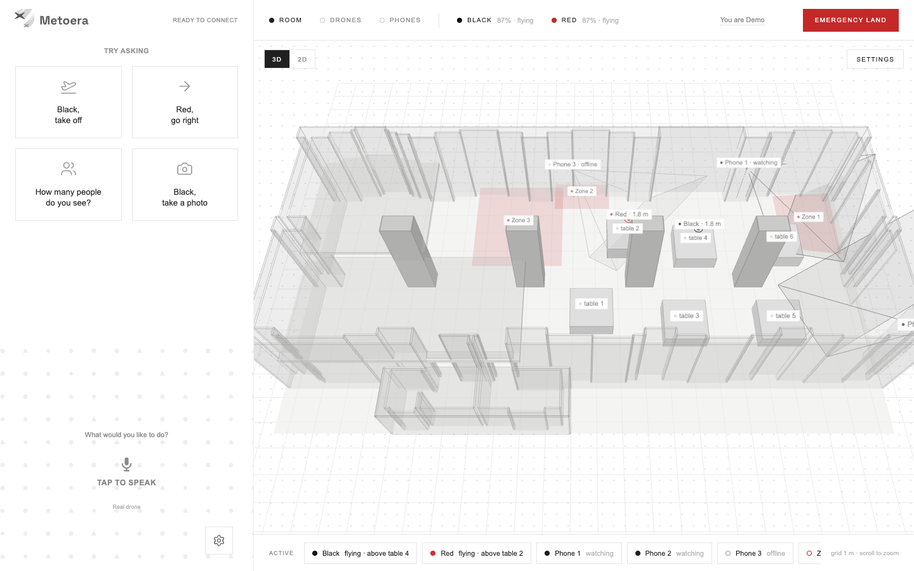
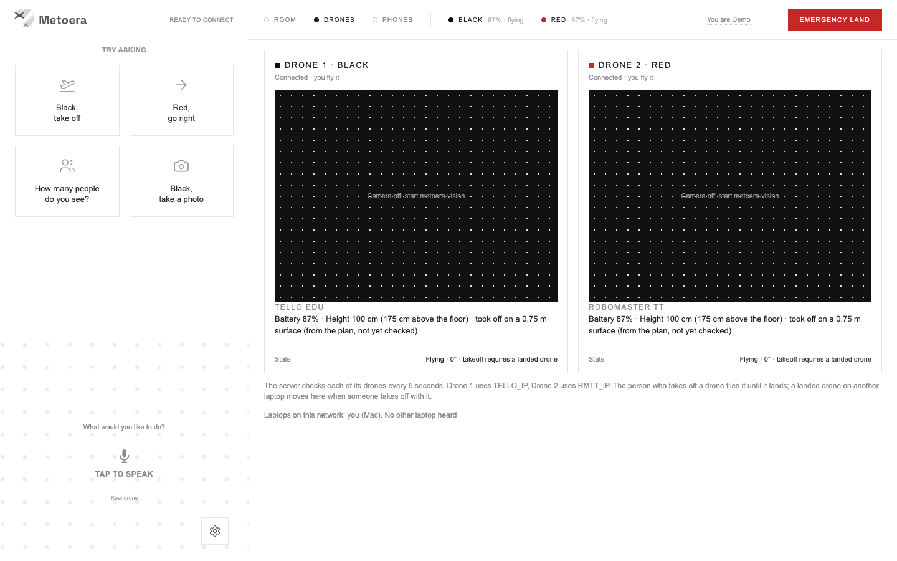

<p align="center"></p>

Metoera flies two real drones indoors: **Black** (a Tello EDU) and **Red** (a RoboMaster TT). You fly them by voice through Grok realtime. Phones act as person detectors: each one watches a red zone drawn on a 3D/2D plan of the venue. When a phone sees a person in a red zone, the nearest drone takes off by itself and plans a route around tables and pillars. It flies into the zone, looks left, ahead and right, and Grok reports what it sees. Then Grok asks you what to do next.

Every command moves a physical drone. There is no simulator.

The venue is the **Capannone Gragnani** (`metoera-voice/room/capannone-gragnani.json`): a hall about 22.8 m long with four pillars and a 4.3 m ceiling.

How the pieces talk to each other (ports, protocols, the zone mission step by step, coordinate frames, safety layers): [docs/ARCHITECTURE.md](docs/ARCHITECTURE.md).

## Demo



These recordings come from the real app; the drones and phones in them are simulated, so the screens can be shown without hardware. Flights with the real drones are in the videos below.

The 3D room with the drones, the phones and the red zones ([MP4](docs/media/room-3d.mp4)):


Drawing a red zone on the plan:


Phones as person detectors: phone 1 sees a person, Zone 1 turns red in the 3D view, and the Phones tab shows each phone's camera, lens, sensitivity and whether it sends a drone:


The two drones, Black and Red:



Flight videos: see [docs/media/videos/](docs/media/videos/).

## Features

**Person detector and red zones (the core).**
- Up to three phones run person detection in the browser (TensorFlow.js COCO-SSD). Each phone is placed on the room plan, with the direction it faces, and watches one red zone.
- You draw red zones on the plan (Room tab, Settings, Add, Red zone).
- When a phone sees a person, the zone it watches raises an alarm. The alarm fires once on entry and not again for 30 s.

**Voice pilot.**
- Grok realtime listens in the browser and calls one tool per action, in the order you said them: take off, land, stop, move, rotate, go to, look, photo, scan and more.
- Grok always speaks English and understands commands in English or Italian.
- The xAI key stays on the server. The browser only gets a temporary token.

**Autonomous zone mission.** On an alarm, the page that claims it does the following:
1. It picks the nearest drone that is connected, free and has at least 25% battery.
2. The drone takes off if it is on the ground.
3. The drone flies into the zone, to a point at least 50 cm from the zone's edges and kept away from pillars and walls.
4. Inside the zone it looks left, ahead and right, one photo each. Grok vision describes who is there, what they look like and what they are doing.
5. Grok says the report aloud and asks: stay and watch, go closer to the person, or fly home and land.

The drone hovers until you answer. If the voice session is not running, the page starts it on the alarm.

**Route planning.**
- "Go to table 3" or "go to Zone 1" becomes a route around tables, pillars and walls. The planner runs A* on a 20 cm grid, then shortens the path to straight legs.
- The drone keeps 50 cm from walls and tables and 80 cm from pillars. A table blocks the drone only when it flies less than 50 cm above the tabletop.
- Legs are at most 2 m long. Before each leg the drone turns to face the way it is going, so the camera sees ahead.

**Telemetry odometry and calibration test.**
- Position comes from the Tello telemetry. How each drone's telemetry reads (units and axes) is learned in flight and kept in `.odometry.json` for the next flight.
- The calibration test flies a fixed pattern from a table: right, left, right, forward, back, forward, twice by default. Each move is measured with the telemetry. The drone then flies back and lands.
- A person measures where the drone really landed and types it into the page. The report is saved in `flights/`.

**Survey and localize with Grok vision.**
- On the first flight to a place after takeoff, the drone climbs a little and takes four photos, turning 90° between them. Grok vision says which pillars and tables of the plan it sees. Position and heading are worked out from that.
- At least two objects must be recognised with confidence of 0.7 or more. Otherwise the drone goes on with telemetry only and says so.
- `localize` does the same check from a single photo.

**Depth check before each leg.**
- With the camera facing the leg, the drone asks `metoera-vision` for metric depth (`/depth`, Depth Anything V2 Metric Indoor).
- If something is closer than 90 cm, the drone stops. Otherwise the leg is shortened so the drone stops 60 cm before what it sees.
- If the depth service does not answer, the leg is flown in full.

**Lost Wi-Fi.** If telemetry stops for 2.5 s while a drone is flying:
- The running mission stops and the drone sends one move back along its own path toward home, about 1.5 m.
- If the link returns, the server flies the drone home with the normal route and checks, then lands it.
- If the link is still lost after 12 s, the server keeps sending `land`. The Tello also lands by itself about 15 s after its last command.

**Emergency land.** One button, always on screen, even without a voice session. It cancels every queued command, interrupts the running one, sends `land` (up to 3 tries) and ends the voice session. Saying "land" or "stop" always goes through, even during a mission. Saying "emergency" or "cut the motors" stops the motors at once, and the drone drops.

**Two laptops and pilot locks.**
- The person whose takeoff is accepted becomes that drone's pilot. Until it lands, nobody else can command it, not even land it.
- If the pilot's page is silent for 15 s, the server lands the drone by itself.
- Several laptops can run the server. Only one laptop holds a drone at a time; the laptops announce this to each other on UDP 18789. A landed drone moves to another laptop when someone there takes off with it. A flying drone never moves.

**Other features.**
- **Preflight:** before a mission, it says what is ready, what is missing and how long the flight should take.
- **Flight log:** every telemetry sample and every command, one JSON line each, in `flights/<drone>-<day>.jsonl`. Photos asked for by voice go to `photos/`.
- **Decision mode:** on by default. During a mission, a fast Grok call picks the next step only when something is off: a failed step, a person on the path, or low battery. Otherwise fixed rules decide.

## Repository map

| Folder | What it does | Language |
| --- | --- | --- |
| [metoera-voice](metoera-voice) | Main app: Grok realtime voice, both drones, room plan with 2D and 3D map, route planning, missions, red zones, the pilot page for a phone | Node.js (TypeScript run directly) |
| [metoera-redzone](metoera-redzone) | Up to three phones as person detectors (COCO-SSD in the browser) and a Mac console to watch them | Node.js |
| [metoera-vision](metoera-vision) | Receives the drones' H.264 video (UDP 11111), runs YOLO, serves detections, frames and metric depth over HTTP | Python |
| [metoera-link](metoera-link) | Small scripts to check the link with one drone and whether this computer has internet | Node.js |
| [metoera-share-wifi](metoera-share-wifi) | Scripts that put a drone on the shared Wi-Fi (station mode) and find its IP | Python |

## Quick start

### Requirements

- macOS. Start the servers from the macOS Terminal app, which has Local Network access.
- Node.js 24.12 or later for `metoera-voice` (it runs `server.ts` directly). Node.js 20 is enough for `metoera-redzone` and `metoera-link`.
- Python 3.13 for `metoera-vision`, Python 3 for `metoera-share-wifi`.
- An xAI API key.
- A 2.4 GHz WPA2-Personal Wi-Fi network for the drones, the laptop and the phones. The network name and password must not contain spaces.

### Ports

| Port | Protocol | Service | Who connects |
| --- | --- | --- | --- |
| 8889 / 8890 | UDP | drones | `metoera-voice` sends commands to 8889 and gets telemetry on 8890 |
| 11111 | UDP | `metoera-vision` | the drones send video here |
| 18786 | HTTP | `metoera-voice` | certificate page, opened once per phone |
| 18787 | HTTP | `metoera-voice` | control page, this laptop only |
| 18788 | HTTPS | `metoera-voice` | pilot page on a phone (needs the access key) |
| 18789 | UDP | `metoera-voice` | the other laptops (who holds which drone) |
| 18790 | HTTP | `metoera-vision` | `metoera-voice`, this laptop only |
| 18791 | HTTP | `metoera-redzone` | Mac console and `metoera-voice` |
| 18792 | HTTPS | `metoera-redzone` | detector phones (need the access key) |

### 1. Put the drones on the shared Wi-Fi

Do this once per drone, or again after a reset. The full steps are in [metoera-share-wifi](metoera-share-wifi).

1. Turn on a drone. On the RoboMaster TT, set the expansion board switch to router mode.
2. Join the laptop to the drone's own access point (`TELLO-XXXXXX` or `RMTT-XXXXXX`). The drone is at `192.168.10.1`.
3. Create the Python environment and send the command:

   ```sh
   cd metoera-share-wifi/drone
   python3 -m venv venv
   source venv/bin/activate
   pip install -r requirements.txt
   cp .env.example .env
   python set_sta_mode.py
   ```

   The script asks for the network name and password, shows them, and sends `ap` after you type `y`. The drone restarts on the shared network. Wait 30 to 60 seconds.
4. Join the laptop to the same Wi-Fi and run `python find_tello.py`. If it finds nothing, set `LOCAL_SUBNET` in `.env` (for example `192.168.5.0/24`) and try again.
5. Write down the IP. Repeat for the other drone, leaving the first one on.

To get the drone's own access point back, turn it on and hold the power button for 5 seconds, until the light flashes yellow.

A VPN that routes `192.168.10.1` blocks the link. If the firewall asks, allow incoming UDP on 8890 and 11111.

Quick link check (nothing takes off):

```sh
node metoera-link/connect.mjs --host <drone IP> --local <laptop IP>
node metoera-link/internet.mjs
```

### 2. metoera-voice

```sh
cd metoera-voice
cp .env.example .env              # then add the xAI key
cp .env.tello.example .env.tello  # then the IP and serial of each drone
npm install
npm start
```

`npm install` only downloads TypeScript and the Node types, for `npm run typecheck`. The server runs without a build.

On start, the server prints:

- `http://localhost:18787`: the control page, on this laptop only.
- `https://<laptop IP>:18788/?key=<key>`: the same page for a phone on the same Wi-Fi. The key is in `metoera-voice/.phone/key.txt`. Do not share it.
- `http://<laptop IP>:18786/`: the certificate page. Open it once on each phone, download `metoera-ca.cer` and install it. On iPhone, also turn it on in Settings → General → About → Certificate Trust Settings.

Close the scripts in `metoera-voice/tools/` first: the server needs UDP 8889, 8890 and 18789. Ctrl+C lands the drones that are flying and hands them over to the other laptops.

Details: [metoera-voice/README.md](metoera-voice/README.md). Notes on the Tello link: [metoera-voice/TELLO.md](metoera-voice/TELLO.md).

### 3. metoera-vision

```sh
cd metoera-vision
python3.13 -m venv .venv
.venv/bin/pip install -r requirements.txt
.venv/bin/python -m metoera_vision --drones tello=<TELLO_IP>,rmtt=<RMTT_IP>
```

Use the same IPs as in `.env.tello`. The service sends nothing to the drones. It only listens for video on UDP 11111 and separates the two streams by sender address. Video arrives after `metoera-voice` has sent `streamon`.

The YOLO weights (`yolo11n.pt`) download on first start. The depth model (Depth Anything V2 Metric Indoor, from Hugging Face) loads in the background at start; `--no-depth` turns it off. Annotated view of one drone: `http://127.0.0.1:18790/stream?drone=tello`.

### 4. metoera-redzone

```sh
cd metoera-redzone
npm start
```

There are no dependencies to install. The server prints the Mac console (`http://127.0.0.1:18791/console`) and one link per phone: `https://<laptop IP>:18792/?key=<key>&slot=1` (also `slot=2` and `slot=3`). The key is in `metoera-redzone/.phone/key.txt`. The certificate is self-signed, so accept it on the phone the first time.

### 5. Environment variables

The values live in `metoera-voice/.env`, `metoera-voice/.env.tello` and `metoera-redzone/.env`. All three are git-ignored. The examples are `.env.example` and `.env.tello.example`. Only the names are listed here; never write values into tracked files.

**metoera-voice, `.env`**

| Variable | Use |
| --- | --- |
| `XAI_API_KEY` | xAI key (required) |
| `DECISION_MODE` | `0` turns off Grok decisions during missions (on by default) |
| `DECISION_MODEL`, `VISION_LLM_MODEL` | Grok models for decisions and for vision |
| `CAMERA_ALWAYS_ON` | `1` keeps the video on all the time. By default it turns on only when needed, to save battery |
| `VISION_URL` | address of `metoera-vision` (default `http://127.0.0.1:18790`) |
| `REDZONE_URL`, `REDZONE_PHONE_PORT` | address of `metoera-redzone`, and the port of its phones |
| `ROOM_PLAN` | another room plan (default `room/capannone-gragnani.json`) |
| `PHONE_ACCESS`, `PHONE_PORT`, `PHONE_CERT_PORT` | `PHONE_ACCESS=off` turns off phone access; the other two change ports 18788 and 18786 |
| `PAD_HOP_MAX_CM` | longest hop between mission pads |

**metoera-voice, `.env.tello`**

| Variable | Use |
| --- | --- |
| `TELLO_IP`, `TELLO_SETUP_SERIAL` | IP and serial of Black (the serial as the drone reports it with `sn?`) |
| `RMTT_IP`, `RMTT_SETUP_SERIAL` | IP and serial of Red |
| `TELLO_SETUP_SSID`, `TELLO_SETUP_PASSWORD` | the shared network, for the setup scripts |
| `TELLO_MAX_MOVE_CM` | longest single move (default 100) |
| `TELLO_START`, `RMTT_START` | start point `x,y,heading` when the drone is not placed on the plan |
| `METOERA_CLIENT_NAME`, `METOERA_PEERS`, `METOERA_CLAIMS_PORT` | several laptops: the name the others see, direct IPs when the Wi-Fi blocks broadcasts, the announcement port |

**metoera-redzone, `.env`**

| Variable | Use |
| --- | --- |
| `REDZONE_ARM_DEFAULT` | `0` starts the phones disarmed (armed by default) |
| `PAD_NAV` | `1` turns the old pad-to-pad mission back on (off by default) |
| `REDZONE_PORT`, `REDZONE_PHONE_PORT` | ports 18791 and 18792 |
| `METOERA_VOICE_URL` | address of `metoera-voice` (default `http://127.0.0.1:18787`) |
| `REDZONE_WEBHOOK_URL`, `REDZONE_DEBOUNCE_MS` | optional webhook, and the shortest time between two alarms of one phone |
| `PAD_NAV_EXECUTE_PATH`, `PAD_NAV_DIRECT` | only for testing the pad mission |
| `PHONE_ACCESS` | `off` turns off phone access |

`metoera-vision` takes the same options on the command line or as `METOERA_VISION_*` variables (port, model, device, fps, depth model). See its README.

### 6. Local files (git-ignored)

These files stay on the laptop and are never committed:

| File | Contents |
| --- | --- |
| `metoera-voice/.env`, `metoera-voice/.env.tello` | xAI key, drone IPs and serials |
| `metoera-voice/.phone/`, `metoera-redzone/.phone/` | phone access key and certificates. Delete the folder to make a new key |
| `metoera-voice/.room.json` | where the drones, phones, tables and red zones are, as set on the page |
| `metoera-voice/.redzone-zones.json` | red zones (ignored for safety; the current zones are in `.room.json`) |
| `metoera-voice/.odometry.json` | telemetry calibration learned in flight |
| `metoera-voice/photos/` | photos taken by voice |
| `metoera-voice/flights/` | flight logs and calibration reports |
| `metoera-redzone/.env`, `metoera-redzone/data/` | redzone settings and its local event log |

## How to use it in the venue

1. **Network.** Drones on the shared Wi-Fi; laptop and phones on the same network. Each drone needs at least 20% battery; takeoff is refused below that.
2. **Start.** Three terminals:
   - `metoera-vision`: `.venv/bin/python -m metoera_vision --drones tello=<TELLO_IP>,rmtt=<RMTT_IP>`
   - `metoera-redzone`: `npm start`
   - `metoera-voice`: `npm start`
3. **Page.** Open `http://localhost:18787`, type your name and start the voice. The pilot of a drone is whoever takes off with it. On the pilot's phone, use the `https://<IP>:18788/?key=<key>` link the server printed.
4. **Detector phones.** The Phones tab lists the `https://<IP>:18792/?key=<key>&slot=N` links. Open them on the phones and put the phones in place. On the plan, mark where each phone stands, where it faces and which zone it watches, or calibrate it with 4 clicks on the plan.
5. **Drones on the plan.** In the Room tab, put each drone on its start point and confirm which way its camera faces. Without this, the drone refuses to fly to a point in the room.
6. **Calibration.** On the first flight in the venue, run the calibration test from a table, then measure where the drone landed and type it in. Run the preflight before a mission.
7. **Red zones.** Draw the zones on the plan. With auto-send on (the default), a person seen in a zone sends the nearest drone, which flies in, looks around and reports.

## Tests

No test flies a drone.

```sh
cd metoera-voice && npm test            # node --test test/*.test.mjs; also: npm run typecheck
cd metoera-redzone && npm test          # node --test test/*.test.mjs
node --test metoera-link/tello-link.test.mjs metoera-link/internet.test.mjs   # from the repository root
cd metoera-vision && .venv/bin/python -m pytest -m "not smoke"   # without -m, the slow tests with the real model also run
cd metoera-share-wifi/drone && python -m unittest test_set_sta_mode.py
```

## Safety

- A person must stand next to every drone in flight.
- **Emergency land** lands at once and cancels queued commands, even without a voice session. "Land" and "stop" by voice always go through, even during a mission.
- Only the pilot can command a flying drone. If the pilot's page goes silent for 15 s, the server lands the drone.
- If the Wi-Fi drops, the drone backs up toward home, then flies home and lands when the link returns, or lands after 12 s.
- Ctrl+C on the `metoera-voice` server lands the drones it is flying.
- The server checks every drone's serial (`sn?`) before sending it anything. It never sends a packet to a drone that another laptop holds.
- Moves are limited to 20–100 cm per command by default. Takeoff needs at least 20% battery; flips need at least 50%.
- These limits are enforced on the server. What Grok decides to call is not. Keep someone next to every drone.

The full list of safety layers is in [docs/ARCHITECTURE.md](docs/ARCHITECTURE.md#safety-layers).

## Known limits

- **Position drifts.** Telemetry odometry is off by about 10 to 15 cm per metre. The survey only corrects it when Grok clearly recognises at least two pillars or tables.
- **Depth is approximate.** The depth model estimates distance from one camera frame. The check before a leg looks only within about 12° of straight ahead.
- **Zone alarms come from the whole phone picture.** Any person a phone sees raises an alarm for the zone that phone watches. The phone's own ROI box and its ARM switch do not stop the voice server from sending a drone; the switch that does is **auto-send** on the voice page.
- **The zone mission runs in a browser page.** At least one `metoera-voice` page must be open, with a name typed in, for an alarm to send a drone.
- **No authentication between laptops.** Anyone on the Wi-Fi could announce a claim on UDP 18789. The `metoera-redzone` console on port 18791 is plain HTTP and is reachable from the local network without a key.
- **RoboMaster TT link not fully checked.** Some Tello link behaviour was confirmed only on the Tello EDU. See [metoera-voice/TELLO.md](metoera-voice/TELLO.md).
- **COCO classes only.** YOLO and COCO-SSD know 80 everyday classes, and nothing is tracked across frames.
- **Two-drone handover.** Nobody has checked yet whether a stray `command` from a second laptop takes a drone's telemetry and video away from the first one. See TELLO.md.
- **The interface is being redesigned.** The page has three tabs, **Room**, **Drones** and **Phones**, with the 3D map in front and one **Emergency land** button. This README does not describe each control.
