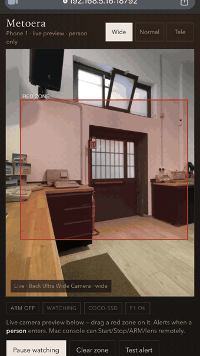
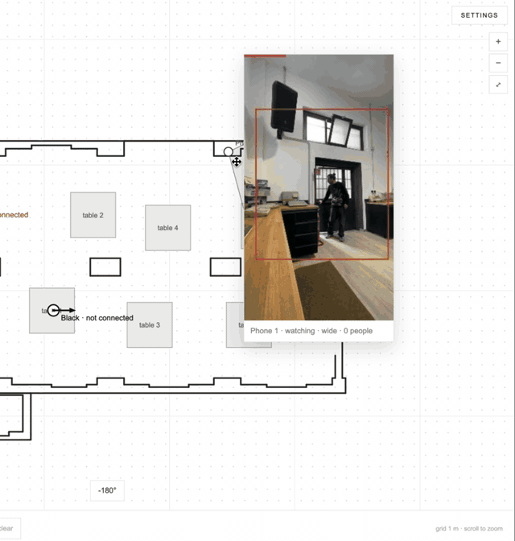
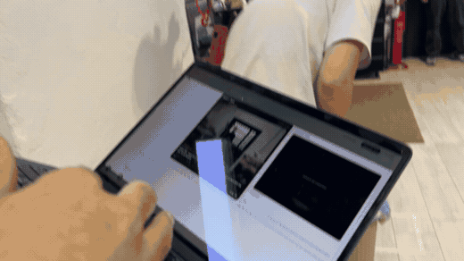
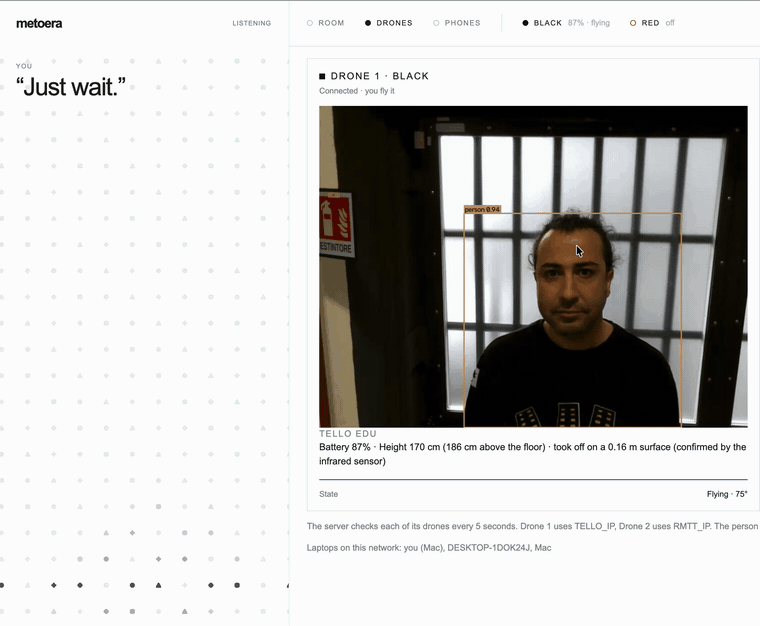
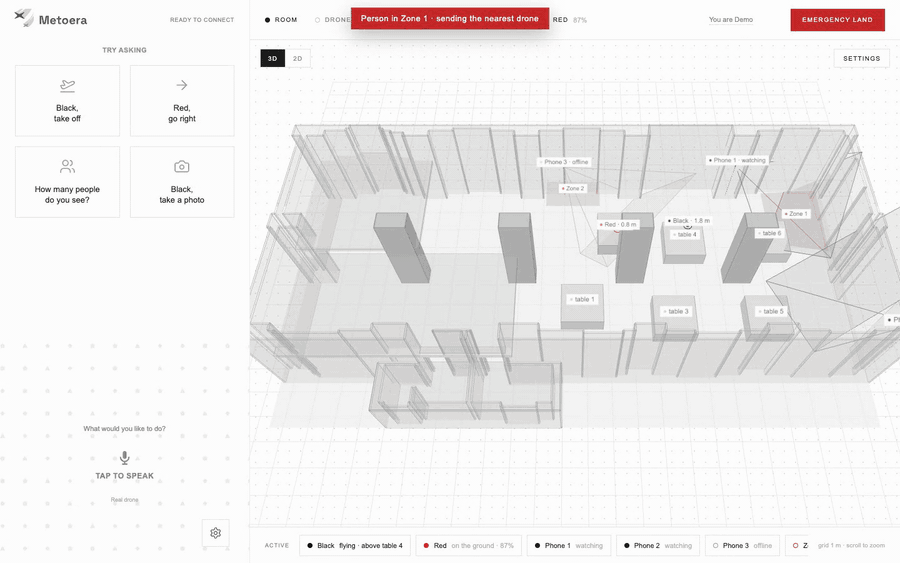
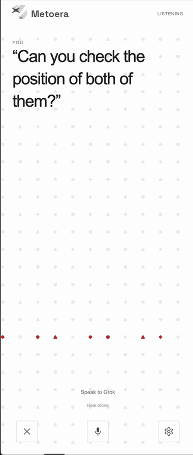
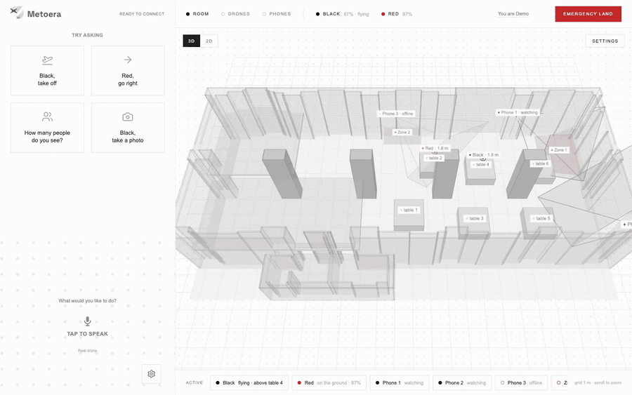
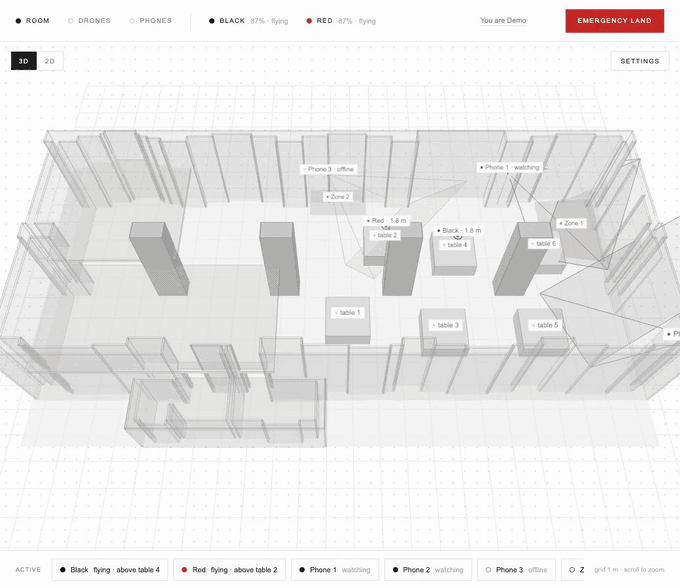
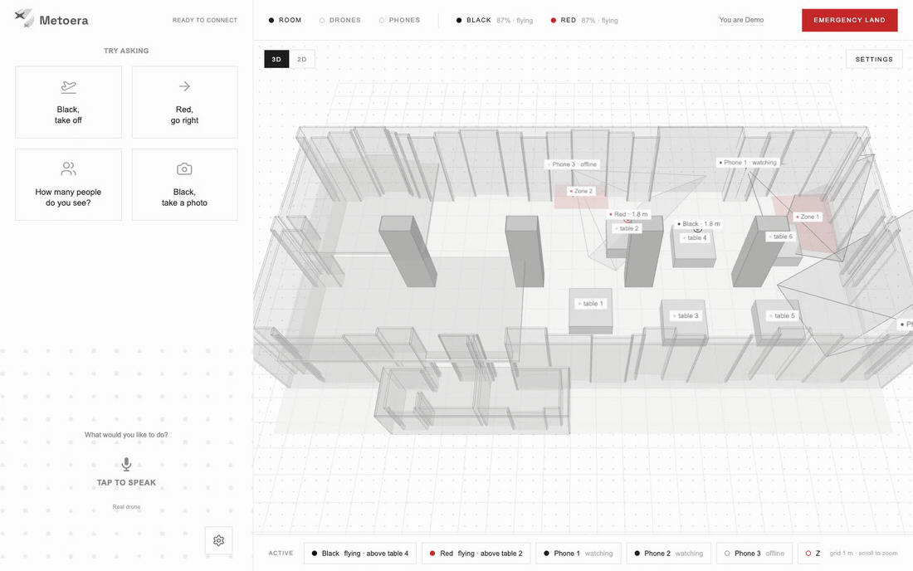
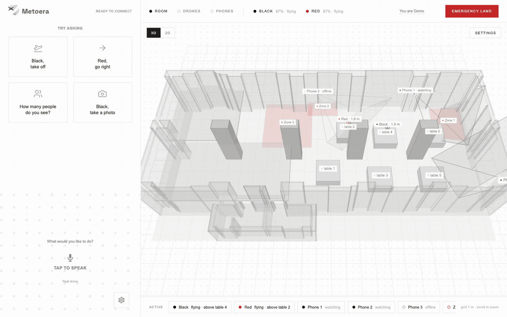

<p align="center"></p>
<h1 align="center">Meteora</h1>

<p align="center"><b>Drone patrol that checks when a camera sees something strange.</b><br>Phones spot a person in a red zone, the nearest drone flies there by itself, looks around and tells you what it sees.</p>

<p align="center">Grok Bot Hackathon · Pavia 2026 · Track D, proposed by Riello</p>

**The problem.** A large site (around 55,000 m² in the brief) is watched by cameras, and every time a camera flags something, someone has to go and check, fast. Guards cannot check every alert, so real events and false alarms wait in the same queue.

**Meteora's answer: look first, then alert.** A camera event reaches Grok, a drone flies there to check, YOLO and Grok describe the scene, and people stay in charge of what happens next.

It runs on off-the-shelf hardware: two small drones (a Tello EDU called **Black** and a RoboMaster TT called **Red**), the phones you already have as cameras, one laptop, and Grok as the voice you talk to. Nothing to install on the phones: they open a link.

Every command moves a real drone. The demo GIFs below say when the drones in them are simulated.

## See it

### 1. A phone spots a person

Any phone becomes a person detector by opening a link. On the phone (left) a person walks into the red box and the phone raises the alarm; on the laptop (right) the phone's view shows the person and the zone turns red on the plan. *(Real recordings.)*

<table><tr>
<td width="34%" align="center"></td>
<td align="center"></td>
</tr></table>

### 2. The nearest drone goes by itself

The alarm sends the nearest free drone. It takes off, plans a route around tables and pillars, flies into the zone, looks left, ahead and right, and Grok says what it saw, then asks what to do next.

In the venue: Black flies across the hall to the person standing in the red zone by the door. *(Real recording; [MP4](docs/media/real-flight.mp4).)*

<p align="center"></p>

What the drone sees when it gets there: YOLO finds the person on the drone camera and Grok describes him, down to the sign on the wall. *(Real recording, 3× speed.)*



The whole sequence on the plan, from the alarm to Grok's question. *(Simulated drones, real app, 2× speed; [MP4](docs/media/zone-mission.mp4).)*



### 3. Talk to the drones

Grok realtime is the pilot: ask in plain English (or Italian) and it calls the right drone actions. The dots turn red while it listens and speaks. *(Real recording.)*

<p align="center"></p>

Both drones at once, each with its own task, from one sentence. *(Simulated drones, real app, 2× speed; [MP4](docs/media/voice-two-drones.mp4).)*



### 4. The venue in 3D

The room at real size: walls, pillars, tables, the phones at their real height with what they see, the drones and the red zones. Click any tag to control it. *([MP4](docs/media/room-3d.mp4).)*



Drawing a red zone takes four clicks:



Each phone's camera, lens, sensitivity and whether it may send a drone, in one place:



Longer real recordings, trimmed: [docs/media/videos/](docs/media/videos/).

## Why it is ready for a real venue

- **Cheap, standard hardware.** Programmable drones that cost a few hundred euros, any phone with a browser, one laptop. No custom electronics.
- **Any camera can watch.** Today a phone joins by opening a link on the venue Wi-Fi, with nothing to install. The detector only needs a picture, so fixed cameras already in the venue (IP / CCTV) are the next source to plug in.
- **Set up in minutes.** One script puts each drone on the Wi-Fi, one command starts everything, zones are drawn on the plan with the mouse.
- **Safe by design.** One Emergency land button, a single pilot per drone, the drone comes home or lands if the Wi-Fi drops, and limits enforced on the server, not left to the AI.
- **Grows with the venue.** More phones, more zones, more drones on the same plan; several laptops can share the drones.

## Set up a venue

1. **Drones on the Wi-Fi** (once per drone): `cd meteora-share-wifi/drone && python set_sta_mode.py`, then `python find_tello.py` to get its IP.
2. **Keys and drones:** in `meteora-voice/`, copy `.env.example` to `.env` and add your xAI key; copy `.env.tello.example` to `.env.tello` and add each drone's IP and serial.
3. **Start everything:**

   ```sh
   ./scripts/start.sh
   ```

   It starts the camera service, the phone detectors and the main app, and prints the links. Ctrl+C stops everything (flying drones land first).
4. **Open** `http://localhost:18787`, type your name, and open the phone links (Phones tab) on the phones you want to use as cameras.
5. **Draw** the red zones, place the phones and the drones on the plan (Room → Settings). Done.

Requirements: macOS, Node.js 24.12 or later, Python 3.13 (for the camera service), an xAI API key, a 2.4 GHz Wi-Fi. Ports, every option, the first-time install of the camera service and the venue checklist are in **[docs/SETUP.md](docs/SETUP.md)**. How the parts talk to each other: **[docs/ARCHITECTURE.md](docs/ARCHITECTURE.md)**.

## The floor plan, and what comes next

Today the plan of the venue (the Capannone Gragnani, 22.8 m with four pillars and a 4.3 m ceiling) is made for this venue: walls and pillars come from its architectural drawing, tables are placed and measured on the page ([room/capannone-gragnani.json](meteora-voice/room/capannone-gragnani.json)).

**Next:** scan the room with a LiDAR phone (any recent iPhone Pro or iPad Pro). A small companion app walks the room once and generates the plan on the spot: walls, pillars and tables at real size, ready to import. A new venue would then be ready in the time it takes to walk through it.

**Also next:** fixed cameras (IP / CCTV streams) as detectors next to the phones; a docking pad per drone so it charges between patrols; a log of every alarm with the drone's photos for the security team.

## What it does

**Person detector and red zones (the core).**
- Up to three phones run person detection in the browser (TensorFlow.js COCO-SSD). Each phone is placed on the room plan, with the direction it faces, and watches one red zone.
- You draw red zones on the plan (Room tab, Settings, Add, Red zone).
- When a phone sees a person, the zone it watches raises an alarm. The alarm fires once on entry and not again for 30 s.

**Voice pilot.**
- Grok realtime listens in the browser and calls one tool per action, in the order you said them: take off, land, stop, move, rotate, go to, look, photo, scan and more.
- Grok always speaks English and understands commands in English or Italian.
- The xAI key stays on the server. The browser only gets a temporary token.

**Autonomous zone mission.** On an alarm, the page that claims it does the following:
1. It picks the nearest drone that is connected, free and has at least 25% battery.
2. The drone takes off if it is on the ground.
3. The drone flies into the zone, to a point at least 50 cm from the zone's edges and kept away from pillars and walls.
4. Inside the zone it looks left, ahead and right, one photo each. Grok vision describes who is there, what they look like and what they are doing.
5. Grok says the report aloud and asks: stay and watch, go closer to the person, or fly home and land.

The drone hovers until you answer. If the voice session is not running, the page starts it on the alarm.

**Route planning.**
- "Go to table 3" or "go to Zone 1" becomes a route around tables, pillars and walls. The planner runs A* on a 20 cm grid, then shortens the path to straight legs.
- The drone keeps 50 cm from walls and tables and 80 cm from pillars. A table blocks the drone only when it flies less than 50 cm above the tabletop.
- Legs are at most 2 m long. Before each leg the drone turns to face the way it is going, so the camera sees ahead.

**Telemetry odometry and calibration test.**
- Position comes from the Tello telemetry. How each drone's telemetry reads (units and axes) is learned in flight and kept in `.odometry.json` for the next flight.
- The calibration test flies a fixed pattern from a table: right, left, right, forward, back, forward, twice by default. Each move is measured with the telemetry. The drone then flies back and lands.
- A person measures where the drone really landed and types it into the page. The report is saved in `flights/`.

**Survey and localize with Grok vision.**
- On the first flight to a place after takeoff, the drone climbs a little and takes four photos, turning 90° between them. Grok vision says which pillars and tables of the plan it sees. Position and heading are worked out from that.
- At least two objects must be recognised with confidence of 0.7 or more. Otherwise the drone goes on with telemetry only and says so.
- `localize` does the same check from a single photo.

**Depth check before each leg.**
- With the camera facing the leg, the drone asks `meteora-vision` for metric depth (`/depth`, Depth Anything V2 Metric Indoor).
- If something is closer than 90 cm, the drone stops. Otherwise the leg is shortened so the drone stops 60 cm before what it sees.
- If the depth service does not answer, the leg is flown in full.

**Lost Wi-Fi.** If telemetry stops for 2.5 s while a drone is flying:
- The running mission stops and the drone sends one move back along its own path toward home, about 1.5 m.
- If the link returns, the server flies the drone home with the normal route and checks, then lands it.
- If the link is still lost after 12 s, the server keeps sending `land`. The Tello also lands by itself about 15 s after its last command.

**Emergency land.** One button, always on screen, even without a voice session. It cancels every queued command, interrupts the running one, sends `land` (up to 3 tries) and ends the voice session. Saying "land" or "stop" always goes through, even during a mission. Saying "emergency" or "cut the motors" stops the motors at once, and the drone drops.

**Two laptops and pilot locks.**
- The person whose takeoff is accepted becomes that drone's pilot. Until it lands, nobody else can command it, not even land it.
- If the pilot's page is silent for 15 s, the server lands the drone by itself.
- Several laptops can run the server. Only one laptop holds a drone at a time; the laptops announce this to each other on UDP 18789. A landed drone moves to another laptop when someone there takes off with it. A flying drone never moves.

**Other features.**
- **Preflight:** before a mission, it says what is ready, what is missing and how long the flight should take.
- **Flight log:** every telemetry sample and every command, one JSON line each, in `flights/<drone>-<day>.jsonl`. Photos asked for by voice go to `photos/`.
- **Decision mode:** on by default. During a mission, a fast Grok call picks the next step only when something is off: a failed step, a person on the path, or low battery. Otherwise fixed rules decide.

## What is in this repository

Five folders, each one a small program that runs on its own and talks to the others over the local network. They are kept apart because they do different jobs, in different languages, and a venue may not need all of them.

| Folder | What it does | Do you need it? |
| --- | --- | --- |
| [meteora-voice](meteora-voice) | The main app: Grok voice, both drones, the plan in 2D and 3D, route planning, missions, red zones | **Always** |
| [meteora-redzone](meteora-redzone) | Turns phones into person detectors (in the browser) and sends the alarms | **Always** (it is the detector) |
| [meteora-vision](meteora-vision) | Reads the drones' video: person detection (YOLO), photos for Grok, distance to obstacles | **Recommended** (without it the drones fly blind: no photos, no obstacle check) |
| [meteora-share-wifi](meteora-share-wifi) | Puts a drone on the venue Wi-Fi and finds its address | **Once per drone** |
| [meteora-link](meteora-link) | Checks that the laptop reaches a drone and the internet | Only to troubleshoot |

Two more folders sit next to them: [`pitch/`](pitch) holds the presentation (open `pitch/index.html` in a browser; arrows or the dots on the right move between slides, G shows all slides; a PDF is in [`pitch/Meteora-pitch.pdf`](pitch/Meteora-pitch.pdf)), and [`design-system/`](design-system) holds the Meteora look (colours, type, icons, tokens) that the app, the pitch and the videos share.

### Scripts

| Script | What it is for | When |
| --- | --- | --- |
| [`scripts/start.sh`](scripts/start.sh) | Starts meteora-vision, meteora-redzone and meteora-voice from one terminal; Ctrl+C stops all three (flying drones land first) | Every time |
| [`meteora-share-wifi/drone/set_sta_mode.py`](meteora-share-wifi/drone/set_sta_mode.py), [`find_tello.py`](meteora-share-wifi/drone/find_tello.py) | Put a drone on the venue Wi-Fi; find its IP | Once per drone |
| [`meteora-voice/tools/`](meteora-voice/tools) | Floor-plan helpers, a supervised test hover, and link diagnostics | Rarely: see [its README](meteora-voice/tools/README.md) |
| [`meteora-vision/scripts/`](meteora-vision/scripts) | Replay recorded drone video to develop without flying | Development only |
| [`meteora-redzone/pad-nav.mjs`](meteora-redzone/pad-nav.mjs), [`tools/pad_recognize.py`](meteora-redzone/tools/pad_recognize.py), `pads/` | The first prototype (fly from pad to pad); off by default (`PAD_NAV=1`) | Not needed |

Settings live in `.env` files next to each app (the examples are committed, the real ones are not). Everything else, ports included, is in [docs/SETUP.md](docs/SETUP.md).

## Tests

No test flies a drone.

```sh
cd meteora-voice && npm test            # node --test test/*.test.mjs; also: npm run typecheck
cd meteora-redzone && npm test          # node --test test/*.test.mjs
node --test meteora-link/tello-link.test.mjs meteora-link/internet.test.mjs   # from the repository root
cd meteora-vision && .venv/bin/python -m pytest -m "not smoke"   # without -m, the slow tests with the real model also run
cd meteora-share-wifi/drone && python -m unittest test_set_sta_mode.py
```

## Safety

- A person must stand next to every drone in flight.
- **Emergency land** lands at once and cancels queued commands, even without a voice session. "Land" and "stop" by voice always go through, even during a mission.
- Only the pilot can command a flying drone. If the pilot's page goes silent for 15 s, the server lands the drone.
- If the Wi-Fi drops, the drone backs up toward home, then flies home and lands when the link returns, or lands after 12 s.
- Ctrl+C on the `meteora-voice` server lands the drones it is flying.
- The server checks every drone's serial (`sn?`) before sending it anything. It never sends a packet to a drone that another laptop holds.
- Moves are limited to 20–100 cm per command by default. Takeoff needs at least 20% battery; flips need at least 50%.
- These limits are enforced on the server. What Grok decides to call is not. Keep someone next to every drone.

The full list of safety layers is in [docs/ARCHITECTURE.md](docs/ARCHITECTURE.md#safety-layers).

## Known limits

- **Position drifts.** Telemetry odometry is off by about 10 to 15 cm per metre. The survey only corrects it when Grok clearly recognises at least two pillars or tables.
- **Depth is approximate.** The depth model estimates distance from one camera frame. The check before a leg looks only within about 12° of straight ahead.
- **Zone alarms come from the whole phone picture.** Any person a phone sees raises an alarm for the zone that phone watches. The phone's own ROI box and its ARM switch do not stop the voice server from sending a drone; the switch that does is **auto-send** on the voice page.
- **The zone mission runs in a browser page.** At least one `meteora-voice` page must be open, with a name typed in, for an alarm to send a drone.
- **No authentication between laptops.** Anyone on the Wi-Fi could announce a claim on UDP 18789. The `meteora-redzone` console on port 18791 is plain HTTP and is reachable from the local network without a key.
- **RoboMaster TT link not fully checked.** Some Tello link behaviour was confirmed only on the Tello EDU. See [meteora-voice/TELLO.md](meteora-voice/TELLO.md).
- **COCO classes only.** YOLO and COCO-SSD know 80 everyday classes, and nothing is tracked across frames.
- **Two-drone handover.** Nobody has checked yet whether a stray `command` from a second laptop takes a drone's telemetry and video away from the first one. See TELLO.md.
