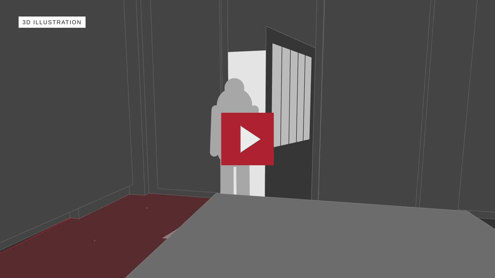

# Meteora demo

[Watch the video](https://github.com/arn9ve/Meteora/blob/main/demo/meteora-demo.mp4) · 75 seconds · 1080p · Audio included

The demo shows a camera alert, a drone checking the zone, and Grok reporting what it sees. It combines a labeled 3D illustration with real recordings.

[Download the MP4](https://github.com/arn9ve/Meteora/raw/refs/heads/main/demo/meteora-demo.mp4) · About 9 MB

[Explore the project](../README.md)
