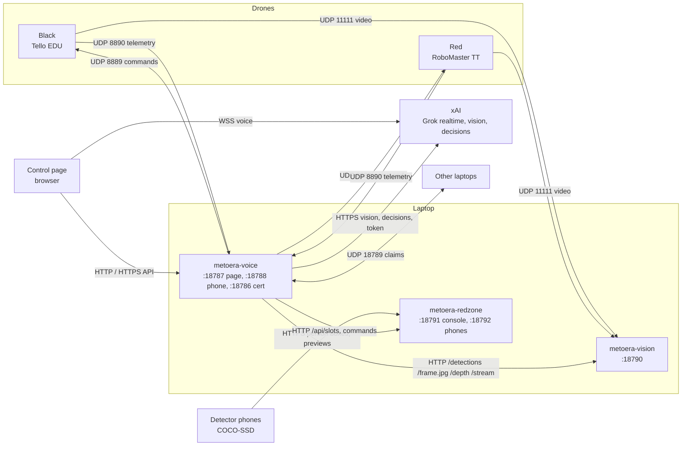
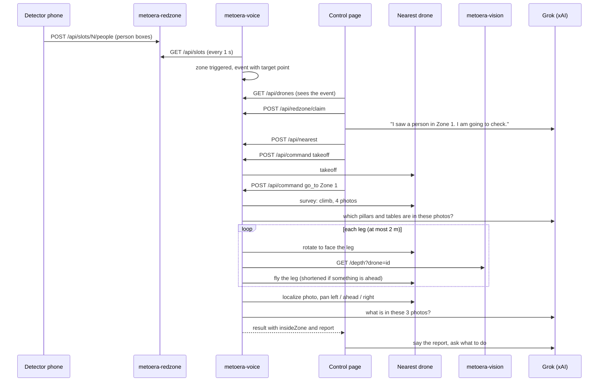

# Metoera architecture

This page explains how the parts of Metoera talk to each other, what happens step by step when a person walks into a red zone, which coordinate frames the code uses, and which safety layers protect a flight.

The facts here come from `metoera-voice/server.ts`, `metoera-voice/src/mission.ts`, `metoera-voice/src/tello.ts`, `metoera-redzone/server.mjs` and `metoera-vision/metoera_vision/server.py`.

## The parts

| Part | Runs on | Job |
| --- | --- | --- |
| `metoera-voice` | the laptop (Node.js) | The brain. Talks to both drones over UDP, holds the room plan, plans routes, runs missions, serves the control page, gets the Grok token, and calls Grok for vision and decisions. |
| `metoera-vision` | the laptop (Python) | Receives the drones' video, runs YOLO and the depth model, and answers HTTP questions about the newest frame of each drone. |
| `metoera-redzone` | the laptop (Node.js) | Collects what the detector phones see (person boxes, preview pictures) and passes commands to them. |
| Detector phones | phone browsers | Run COCO-SSD person detection on the phone's camera and post the person boxes to `metoera-redzone`. |
| Control page | a browser on the laptop or the pilot's phone | Voice session with Grok realtime, the 3D/2D room, the drone and phone panels. It also starts the zone mission when an alarm comes in. |
| Drones | Tello EDU (Black, id `tello`) and RoboMaster TT (Red, id `rmtt`) | Speak the Tello text SDK on the shared Wi-Fi. |
| xAI | the internet | Grok realtime voice, Grok vision, and Grok decisions. |

## Ports and connections

| From | To | Port | What |
| --- | --- | --- | --- |
| `metoera-voice` | each drone | UDP 8889 | SDK commands (`command`, `sn?`, `takeoff`, `forward 50`, …). The server binds local port 8889 too, because the Tello always replies to port 8889. |
| each drone | `metoera-voice` | UDP 8890 | telemetry (height, yaw, speed, battery, mission pad), about 10 times a second |
| each drone | `metoera-vision` | UDP 11111 | raw H.264 video, after `metoera-voice` sends `streamon` |
| `metoera-voice` | `metoera-vision` | HTTP 18790 | `GET /detections`, `/frame.jpg`, `/depth`, `/stream`, each with `?drone=tello` or `?drone=rmtt` |
| browser on the laptop | `metoera-voice` | HTTP 18787 | control page and API, bound to `127.0.0.1` |
| pilot's phone | `metoera-voice` | HTTPS 18788 | the same page and API, with the access key |
| any phone | `metoera-voice` | HTTP 18786 | certificate page only (no drones, no key) |
| `metoera-voice` | other laptops | UDP 18789 | claims: which laptop holds which drone (broadcast, or `METOERA_PEERS`) |
| detector phones | `metoera-redzone` | HTTPS 18792 | join, heartbeat, person boxes, preview pictures, commands |
| `metoera-voice` and the Mac console | `metoera-redzone` | HTTP 18791 | `GET /api/slots` every second, phone previews, phone commands |
| browser | xAI | WSS | Grok realtime voice, with a 5-minute token from `metoera-voice` `POST /session` |
| `metoera-voice` | xAI | HTTPS | Grok vision (photos) and Grok decisions (text), with `XAI_API_KEY` |

### metoera-voice API (main routes)

- `GET /api/drones`: both drones, their pilot, owner, battery and flight state, the other laptops, and the phone slots.
- `GET /api/live`: server-sent events, 10 times a second, with each drone's pose, its last decision and its plan.
- `GET /api/room`, `GET /api/map`: the floor plan, tables, red zones, phones and drones.
- `GET /api/route?drone=&place=`: preview of a route. Nothing moves.
- `POST /api/command {droneId, action, ...}`: every drone action. It checks the claim, the pilot lock and the drone's state first.
- `POST /api/emergency {kind: "land" | "motors"}`: skips the command queue.
- `POST /api/nearest {x, y}`: picks the drone that can reach a point first.
- `POST /api/redzone/claim {id}`: the first page to claim a zone alarm is the one that sends a drone.
- `POST /api/room/drone`, `/api/room/camera`, `/api/room/zones`, `/api/room/objects`: edits from the Room panel, saved in `.room.json`.
- `POST /session`: a temporary Grok realtime token.

Every `POST` must come from the page's own origin.

### metoera-vision API

All per-drone routes need `?drone=<id>`.

- `GET /health`: frame rate, detection rate and errors per drone.
- `GET /detections`: the newest YOLO result (normalised boxes).
- `GET /find?label=person`: the best match for one COCO label.
- `GET /frame.jpg`: the newest frame with boxes drawn.
- `GET /stream`: MJPEG stream.
- `GET /depth`: metric depth from Depth Anything V2 Metric Indoor (`metoera_vision/depth.py`). The answer has a depth per detected object and a row of `columns`, each with a bearing in degrees and a depth in metres. It answers 503 when depth is off (`--no-depth`) or no frame has arrived yet.

### metoera-redzone API (main routes)

- `POST /api/slots/:id/join | heartbeat | people | preview | intrusion | command`: used by the phones.
- `GET /api/slots`: every phone, with online, watching, armed, lens, and the latest person boxes. `metoera-voice` reads this every second.
- `GET /api/slots/:id/preview.jpg`, `preview.mjpeg`: the phone's picture, for the console and the Room panel.
- `GET /api/stream`: server-sent events for the console.
- `GET /api/pad-nav`, `POST /api/pad-nav/claim | phase | command`: the old pad-to-pad mission. It is off unless `PAD_NAV=1`.

## The zone mission, step by step

1. **A phone sees a person.** The phone runs COCO-SSD on its camera and posts the person boxes (normalised to 0–1), at most twice a second, to `metoera-redzone` (`POST /api/slots/N/people`).
2. **metoera-voice reads the phones** every second (`GET /api/slots`). If a calibrated phone is placed on the plan, the feet of each person are projected onto the floor. Otherwise the position is estimated from where the phone stands and faces.
3. **A zone is triggered.** Each phone watches one zone: the zone set for it, or the only zone, or the zone nearest to the phone. A zone is triggered when a phone that watches it sees a person, or when a person on the plan stands inside it. The alarm fires once on entry and not again for 30 s. The server stores it as an event, with a target point inside the zone. That point is at least 50 cm from the zone's edges, as far as possible (up to 1 m) from walls and pillars, and close to the middle.
4. **A page claims it.** Every open control page polls `/api/drones` every 1.5 s and sees the new event. If auto-send is on (the default), the page calls `POST /api/redzone/claim`. Only the first page wins. The page also starts the Grok voice session if it is not running, and Grok says "I saw a person in Zone 1. I am going to check."
5. **The nearest drone is picked** (`POST /api/nearest`). It must be held by this laptop, be connected, not be flown by someone else, and have at least 25% battery. A drone on the ground counts 100 cm extra for the takeoff.
6. **Takeoff** if needed: at least 20% battery, and the person on the page becomes the pilot.
7. **`go_to` the zone.** The server turns the zone name into the target point, then runs `missionGoTo` (`src/mission.ts`):
   1. **Survey** (first flight after a takeoff): the drone climbs a little and takes four photos, turning 90° between them. Grok vision names the pillars and tables it sees, and the pose is corrected. If fewer than two objects are recognised with confidence of 0.7 or more, the drone keeps its telemetry pose and says so.
   2. **Plan in words.** The drone says the distance, the turn, and the number of legs.
   3. **Loop, at most 30 steps.** Each step re-plans the route with A* from the current pose. Tables count as obstacles only if the drone is less than 50 cm above them. The next leg ends at the next waypoint, at most 2 m away. The fixed rules choose the step. Grok is asked (1.5 s at most) only when something is off: the last step failed, a person stands within 2 m of the leg, or the battery is at 20% or less.
   4. **Each leg.** The drone turns to face the leg, then calls `ahead`: the camera frame goes to `/depth`, and the nearest depth within ±12° of straight ahead is read. If something is under 0.9 m away, the leg is not flown. Otherwise the leg ends 0.6 m before it. Then the drone flies the leg.
   5. **Stops.** The mission stops if the drone lands, if the link is lost, after a stop, land or emergency command, after three steps that did not move it, or after 10 s of waiting for a person on the path.
8. **Arrival in the zone.** The drone checks it is inside the polygon, makes one short correction if not, then takes a `localize` photo to confirm, and corrects again if needed.
9. **Pan report.** The drone turns 60° left (photo), back to straight ahead (photo), 60° right (photo), then back to where it faced. All three photos go to Grok vision with a prompt asking who is there, what they look like, what they are doing, and anything unusual.
10. **Grok asks what to do.** The page tells Grok what the drone saw. Grok says it aloud and asks: "Stay here and watch, go closer to the person, or fly home and land?" The drone hovers until it gets an answer. The answers map to doing nothing, `approach` the person, or `go_to home` then `land`.

## Coordinate frames

| Frame | Units | Axes | Used by |
| --- | --- | --- | --- |
| Room plan | metres | x to the right, y up, as drawn in the plan; angles in degrees counterclockwise from +x | `room/capannone-gragnani.json`, `.room.json` (drones, phones, zones, tables), `/api/room`, route planning (`src/room.ts`) |
| Drone pose | centimetres | the same axes as the plan (x right, y up), heading counterclockwise from +x | `src/world.ts`, `/api/live`, `/api/command` with `x`, `y` |
| Phone picture | 0 to 1 | u to the right, v down, from the top-left corner | person boxes from the phones and from YOLO |
| Drone camera bearing | degrees | 0 straight ahead, positive to the right of the picture | `/depth` columns, localize and survey |

- A drone placed on the plan starts at its plan point × 100 (metres to cm), with the heading confirmed on the page. So the plan frame and the drone frame are the same, only in different units.
- A drone that is not placed on the plan uses `TELLO_START` / `RMTT_START` (`x,y,heading` in cm). Defaults: Black at `0,0,0`, Red at `0,-150,0`. In that case the frame starts at the first takeoff: x is the direction the drone faced, y is its left. Some older messages (the `/api/map` `frame` field and parts of the Grok prompt) still describe this older frame.
- The Tello SDK itself only knows relative moves (`forward`, `left`, `cw`, …). `src/tello.ts` turns a target in room cm into those moves, using the current pose and heading.
- Height (`zFloor`) is in cm above the floor: the drone's height since takeoff plus the height of the surface it took off from (for example a table on the plan).

## Safety layers

From the network level up to the person:

1. **Identity.** Before any command, the server sends `command` and checks `sn?` against `TELLO_SETUP_SERIAL` / `RMTT_SETUP_SERIAL`. If the serial does not match, every action is refused.
2. **One laptop per drone.** The laptops announce claims on UDP 18789. A laptop never sends a packet to a drone that another laptop holds. A flying drone is locked to its laptop. A landed drone is handed over: the old laptop sends `streamoff` and goes quiet, then the new laptop sends `command`, `sn?`, `streamon`.
3. **One pilot per drone.** The person whose takeoff is accepted is the pilot. Only the pilot can command the drone, land it included, until it lands. Status, look and photo stay open to everyone.
4. **Absent pilot.** If no page with the pilot's name has been heard from for 15 s, the server lands the drone, trying again every 5 s.
5. **Command checks.** Moves are 20 to 100 cm (`TELLO_MAX_MOVE_CM`, up to 500). Takeoff needs at least 20% battery, flips at least 50%. One request is in flight at a time, and a reply is only accepted if it has the expected shape, so a late `ok` is never taken as the answer to something else.
6. **Keepalive.** `battery?` every 5 s while connected, so the Tello does not land itself after 15 s of silence. This stops when the link is lost.
7. **Known facing.** `go_to` is refused until a person confirms on the plan which way the drone's camera faces.
8. **Route clearance.** Routes keep 50 cm from walls and tables and 80 cm from pillars. A tall target (above a table) gets a safe height.
9. **Depth before each leg.** The drone does not fly a leg with something less than 0.9 m ahead, and stops 0.6 m before what it sees.
10. **People on the path.** A person within 2 m of the next leg (other than the one in the target zone) makes the drone wait. After 10 s it stops and hovers.
11. **Lost link.** No telemetry for 2.5 s in flight: the mission stops, and the drone sends one move of up to 2 m back along its trail toward home. Link back: it flies home with the normal checks, then lands. Still lost after 12 s: `land` is sent every 1.5 s. The Tello also lands by itself after about 15 s.
12. **Emergency.** **Emergency land** and spoken "land" or "stop" skip the command queue. "Emergency" or "cut the motors" by voice stops the motors at once, and the drone drops.
13. **Shutdown.** Ctrl+C lands every drone this laptop is flying, stops the video, and frees the drones for the other laptops.
14. **Access.** The phone pages need a 32-character access key, given in the link and then kept in a cookie. Phones trust a local certificate authority that is limited to private LAN addresses and lasts 90 days. `POST` requests must come from the page's own origin.

These limits are enforced on the server. What Grok decides to call is not, so a person must stand next to every drone.
